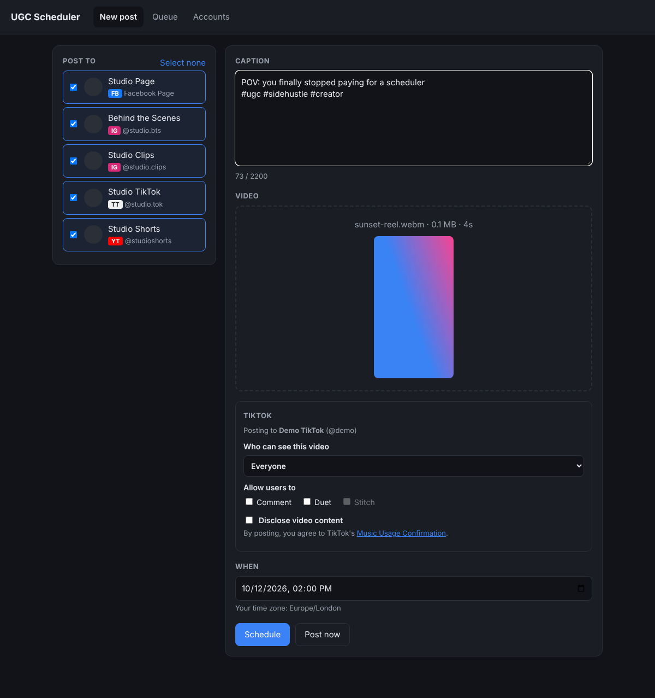
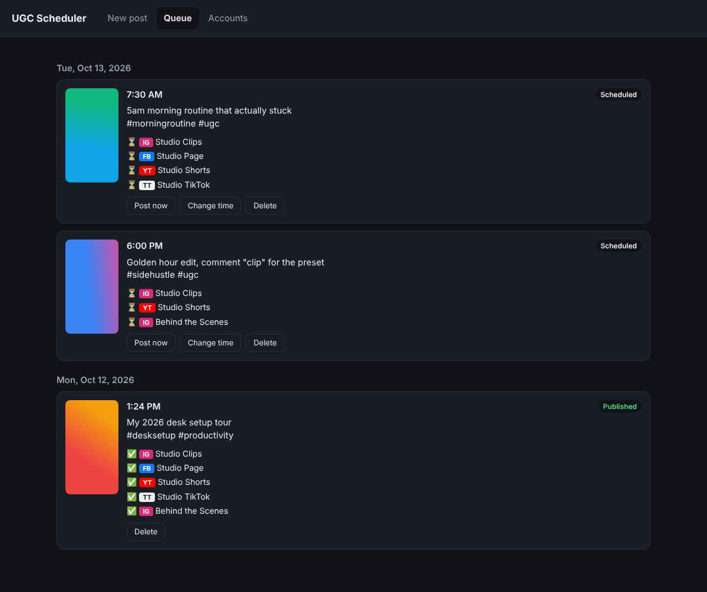
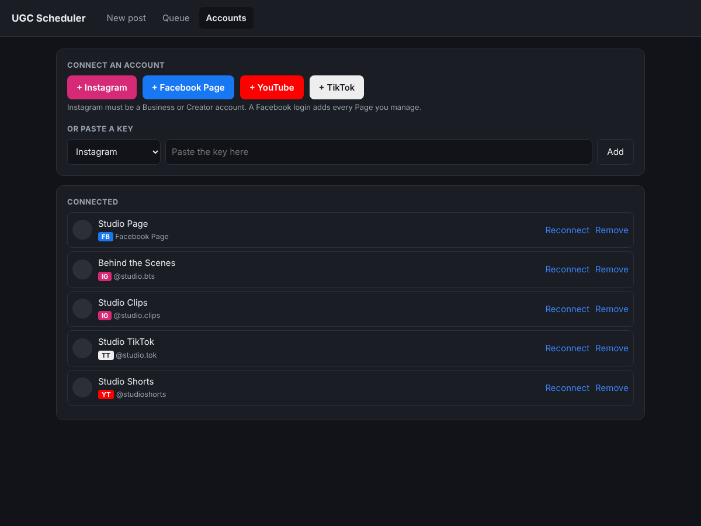

# UGC Scheduler

Schedule one short video to **Instagram Reels, Facebook Reels, YouTube Shorts and TikTok** across many accounts at once, from one screen.

I built this to replace a paid social media scheduler. It does the one thing I used it for: pick accounts, write a caption, choose a video and a time, and the app publishes it everywhere at that time. It runs on your own computer or server, so your keys and login tokens stay with you.

| New post | Queue |
|---|---|
|  |  |

<details><summary>Accounts screen</summary>


</details>

_Screenshots are from `npm run demo` with fake accounts._

## Features

- One post goes to any mix of Instagram, Facebook Page, YouTube and TikTok accounts
- Schedule for later or post now
- Queue view with live status per account, and **Retry failed** for any account that errored
- Connect several accounts per platform with OAuth (tokens refresh automatically)
- TikTok's required posting options (privacy, comments/duet/stitch, content disclosure)
- `npm run demo` mode with fake accounts, so anyone can try it without API keys
- No build step, no external database: Node.js, Express and the built-in `node:sqlite`

## Tech stack

Node.js 22 · Express · SQLite (`node:sqlite`) · vanilla HTML/CSS/JS · Node's built-in test runner (platform APIs mocked)

## How it works

```
Browser (New post / Queue / Accounts)
   │  upload video + caption + time + accounts
   ▼
Node server (Express) ──► SQLite (data/scheduler.db) + video files (data/videos/)
   │
   └─ scheduler, every 20s: finds posts that are due and publishes each account in parallel
        ├─ Instagram  → Instagram API with Instagram Login: REELS container from a one-time video link, publish
        ├─ Facebook   → Pages API /video_reels: start, upload, finish
        ├─ YouTube    → Data API v3 videos.insert (resumable). Vertical and ≤3 min = Short
        └─ TikTok     → Content Posting API: direct post (or send to inbox), chunked upload
```

Each account succeeds or fails on its own. A failed account shows the platform's error in the Queue with a **Retry failed** button.
Facebook, YouTube and TikTok receive the file by direct upload. Instagram only accepts a link, so that one video is shared briefly on a one-time URL (see below).

## Running it

Needs Node.js 22.13 or newer.

```bash
npm install
cp .env.example .env     # then fill in the keys below
npm start                # http://localhost:3000
npm run demo             # try it with fake accounts; nothing is really posted
npm test
```

**It has to be running at the scheduled time.** Two options:

1. **Your own PC**, while it is switched on. Platform logins need a public HTTPS address (TikTok refuses `localhost`), so put a free [Cloudflare Tunnel](https://developers.cloudflare.com/cloudflare-one/connections/connect-networks/) in front of it and use that address as `BASE_URL`.
2. **A small always-on server** (any cheap VPS, or a free-tier VM) with a domain or tunnel for HTTPS. This is the reliable option.

Set `APP_PASSWORD` before the app is reachable from the internet.

Each platform's redirect URI is `BASE_URL/auth/<platform>/callback`, for example `https://posts.example.com/auth/instagram/callback`.

## Setting up each platform (needs your own accounts)

Every platform requires you to create a free developer app. Because only you will use it, Meta needs no review at all. YouTube and TikTok post **privately** until they approve your app; see the notes.

### Instagram and Facebook (one Meta app)

1. Go to [developers.facebook.com](https://developers.facebook.com/apps) and create an app (type **Business**). Add the use cases **Manage messaging & content on Instagram** and **Manage everything on your Page**.
2. **Instagram, quickest way (no HTTPS needed):** open *Instagram → API setup with Instagram login*, add each account as a tester (see below), then under *Generate access tokens* press **Add account**, log in, and **Generate token**. Paste each token into the app's *Accounts → Or paste an Instagram token* box. The app refreshes it automatically before its 60 days run out, as long as it is running.
   **Instagram, login-button way:** open *Instagram → API setup with Instagram login*.
   - Copy the **Instagram app ID** and **Instagram app secret** into `IG_APP_ID` / `IG_APP_SECRET` (they differ from the Meta app ID).
   - Under *Set up Instagram business login*, add the redirect URL `BASE_URL/auth/instagram/callback`.
   - Under *App roles → Roles*, add each Instagram account as an **Instagram Tester**, then accept the invite in Instagram (*Settings → Website permissions → Apps and websites → Tester invites*).
   - The accounts must be **Business** or **Creator** accounts.
3. **Facebook Page:** open *Facebook Login for Business → Settings* and add `BASE_URL/auth/facebook/callback` to *Valid OAuth Redirect URIs*. Copy *App settings → Basic* App ID and secret into `FB_APP_ID` / `FB_APP_SECRET`.
4. Leave the app in **Development** mode. Everything works for accounts that have a role on the app, so App Review is not needed.

**How the video reaches Instagram:** this API does not accept a file upload, only a public link. So while a post is processing, the app serves that one video on a one-time, unguessable URL through a temporary [cloudflared](https://developers.cloudflare.com/cloudflare-one/connections/connect-networks/downloads/) quick tunnel, then withdraws it. Nothing else is reachable through the tunnel, and it closes a minute after the last post. Install it once with `winget install Cloudflare.cloudflared` (or `brew install cloudflared`). If the app already has a public HTTPS address, set `PUBLIC_URL` and no tunnel is used.

Limits: Instagram allows 100 API posts per account per 24 hours. Facebook Reels must be 3–90 seconds.

### YouTube

1. In [Google Cloud Console](https://console.cloud.google.com/), create a project and enable **YouTube Data API v3**.
2. *Google Auth Platform → Branding/Audience*: user type **External**. Then press **Publish app** to move it to *In production*.
   - While it stays in *Testing*, Google expires the login every 7 days and you would have to reconnect weekly.
   - Google will show an "unverified app" warning when you connect. Click *Advanced → Go to app*; that is fine for personal use.
3. *Clients → Create client → Web application*, with the authorized redirect URI `BASE_URL/auth/youtube/callback`. Copy the client ID and secret into `GOOGLE_CLIENT_ID` / `GOOGLE_CLIENT_SECRET`.
4. **Important:** YouTube locks videos uploaded through a new, unaudited API project to **Private**. To post publicly, submit the free [YouTube API Services audit form](https://support.google.com/youtube/contact/yt_api_form). Until it is approved, uploads arrive private and you can make them public in YouTube Studio.
5. The default quota is 10,000 units per day and an upload costs about 1,600, so roughly 6 uploads a day per Google project. The same audit form can ask for more.

The first line of the caption becomes the video title (max 100 characters). The whole caption is the description.

### TikTok

1. At [developers.tiktok.com](https://developers.tiktok.com/), create an app and add the products **Login Kit** and **Content Posting API** (turn on *Direct Post*). Scopes: `user.info.basic`, `video.upload`, `video.publish`.
2. Add the redirect URI `BASE_URL/auth/tiktok/callback` (must be HTTPS; if the app runs on `localhost`, point it at any HTTPS page you own that forwards to that address with the same query string, and set it as `TIKTOK_REDIRECT_URI`). Copy the client key and secret into `TIKTOK_CLIENT_KEY` / `TIKTOK_CLIENT_SECRET`.
3. To try it before review, use the app's **Sandbox**, add your TikTok accounts as target users, and use the sandbox keys.
4. **Important:** until TikTok audits the app, direct posts can only be **private** (`TIKTOK_PRIVACY=SELF_ONLY`). To post publicly, submit the app for review (it asks for an app icon, Terms of Service and Privacy Policy URLs, and a demo video of the app), then request the Content Posting API audit. Once approved, set `TIKTOK_PRIVACY=PUBLIC_TO_EVERYONE`.
5. Workaround meanwhile: `TIKTOK_MODE=inbox` sends the video to your TikTok inbox at the scheduled time, and you finish posting it in the app with one tap.

## Video tips

Use vertical 9:16 MP4 (H.264/AAC), 1080×1920. Keep it **under 90 seconds** if it also goes to Facebook, and under 3 minutes for YouTube Shorts.

## Files

- `src/server.js`: web app, OAuth logins, post API
- `src/scheduler.js`: finds due posts and publishes them
- `src/platforms/*.js`: one file per platform
- `public/`: the web page
- `data/`: database and uploaded videos (back this up; it holds your login tokens; git-ignored)

## License

MIT
